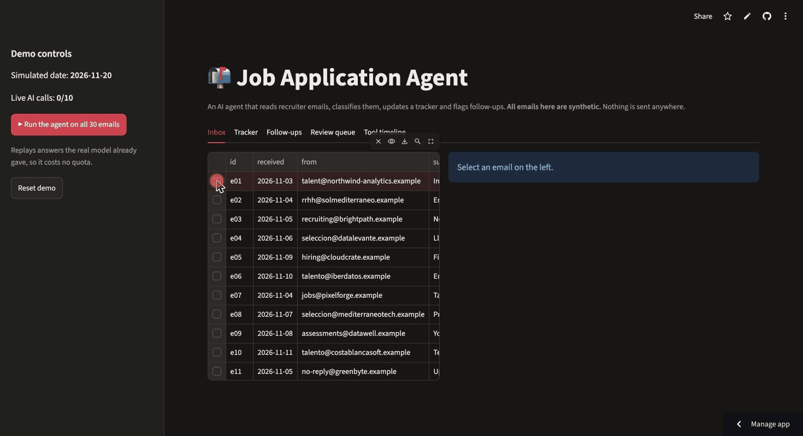
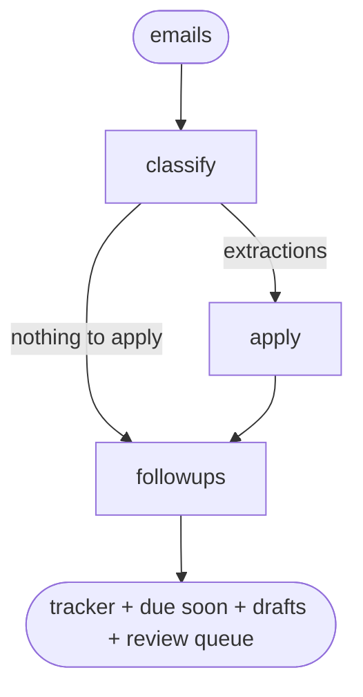

# 📬 Job Application Agent

An AI agent that reads recruiter emails, **classifies** them (interview, test, rejection, info request, acknowledgement), **updates a tracker** and **flags follow-ups**. Built from my own job search: after ~190 applications, replies were scattered across the inbox.

Built with **Python · LangGraph · Gemini (free tier) · Gmail API (read-only) · Google Sheets · Streamlit**. Everything runs on free tiers.

> 🔗 **Live demo:** [job-application-agent-xxdsl3jntxsgwh9ctxkwbf.streamlit.app](https://job-application-agent-xxdsl3jntxsgwh9ctxkwbf.streamlit.app/)
>
> The public demo uses **only synthetic emails**. Each visitor gets a small budget of live AI calls to protect the free Gemini quota.



## How it works



| Node | What it does |
|---|---|
| `classify` | The model extracts category, company, role and the one date that matters from each email (structured output, falls back to other free models on quota errors). A failure on one email never stops the run |
| `apply` | Updates the tracker. A later stage is never overwritten by an earlier one (a late "application received" email will not reset an interview), and a rejection is final. Newsletters and alerts are ignored. Missing company/role goes to a **review queue** instead of polluting the tracker |
| `followups` | Lists actions due in the next 48 h and applications with no news for 10+ days, and **drafts** a follow-up for each (text only) |

### Safety by design
- **Read-only Gmail** (`gmail.readonly`): the agent cannot send, delete or label anything.
- Follow-ups are **drafted, never sent**.
- Low-quality extractions go to a human review queue.
- The public demo never touches a real inbox. Credentials are git-ignored.

## Evaluation

30 synthetic labelled emails (16 English, 14 Spanish):

| | Category accuracy |
|---|---|
| Keyword baseline (generic regex) | 63% (19/30) |
| LLM classifier (Gemini, structured output) | 100% (30/30), plus 100% on company, role and due date |

The emails are synthetic and cleaner than a real inbox, so read 100% as "the pipeline works", not as a production accuracy claim. Details and reproduction in [docs/eval.md](docs/eval.md).

## Run it

```bash
python3.12 -m venv .venv && source .venv/bin/activate
pip install -r requirements-dev.txt
ruff check . && pytest -q                 # tests need no API key (simulated model)

cp .env.example .env                       # add a free Google AI Studio key
streamlit run app.py                       # web demo
PYTHONPATH=src python -m job_agent.agent   # CLI on the demo emails -> demo_output/tracker.csv
PYTHONPATH=src python -m job_agent.evaluate --baseline --out docs/eval.md
```

To use your own Gmail and Google Sheet, follow [docs/SETUP.md](docs/SETUP.md) and read its privacy note first: on the free tier, Google may use submitted text to improve its products.

## Project layout

```
app.py                  Streamlit demo
src/job_agent/
  agent.py              LangGraph graph (classify -> apply -> followups)
  classifier.py         LLM classifier + keyword baseline
  tracker.py            CSV tracker (upsert, stale detection)
  sheets_tracker.py     Google Sheets tracker (same interface)
  sources.py            Demo and read-only Gmail email sources
  followups.py          Deadlines, stale applications, drafted messages
  demo_session.py       Per-visitor state and AI-call budget
demo_data/emails.json   30 synthetic labelled emails
tests/                  Unit tests with fake LLM, Gmail and Sheets services
```

## What I learned
- Tool-style pipelines need **business rules the model cannot be trusted with**: status ordering and a review queue live in code, not in the prompt.
- Free-tier LLMs hit quota and 503s: model fallbacks and "a failed draft must not abort the run" were needed in practice, not in theory.
- A first keyword baseline that I had tuned on my own data scored 100%, which proved nothing. A generic one gives an honest comparison.
- Generated follow-up drafts invented facts about companies until the prompt forbade it.

## Limits
- Evaluated on synthetic emails only; real-inbox accuracy is unknown.
- The real Gmail/Sheets OAuth flow is covered by tests with fake services and has not been exercised against live Google APIs yet.
